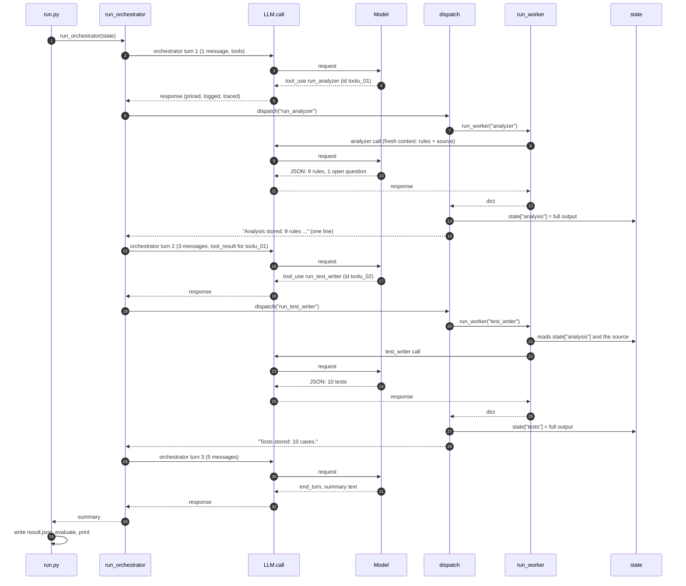

# Call flow: who calls whom, and what each call sees

If the code is hard to follow, it is usually because two different conversations
are running at once. The orchestrator has one long conversation that grows every
turn. Each worker gets a short, fresh conversation that is thrown away after it
answers. This page walks through both.

Watch it happen as you read:

```bash
uv run run.py legacy/ORDPRICE.cbl --fake --trace     # prints every step as it starts and ends
uv run python -m harness.telemetry runs/<run_id>     # the same run, afterwards, as a tree
```

## 1. The call graph

Every arrow is a function call. File names on the right.

```
run.py  main()
 ├─ Tracer(...), LLM(...)                                  harness/telemetry.py, harness/llm.py
 ├─ run_orchestrator(state, llm, max_turns)                harness/orchestrator.py
 │    loop, once per turn:
 │    ├─ llm.call("orchestrator", ..., tools=TOOLS)        harness/llm.py
 │    │    ├─ budget check            (raises BudgetExceeded)
 │    │    ├─ client.messages.create  (or a scripted reply in --fake mode)
 │    │    └─ _log()                  (tokens.jsonl)
 │    └─ dispatch(tool_name, args, state, llm)             harness/orchestrator.py
 │         └─ run_worker("analyzer" | "test_writer", ...)  harness/agents.py
 │              ├─ load_agent(), build_inputs(),           harness/context.py
 │              │  system_prompt()
 │              ├─ llm.call(worker, ...)                   harness/llm.py
 │              └─ parse_json()                            harness/agents.py
 ├─ evaluate(result)                                       evals/check.py
 │    └─ price(test inputs)   the oracle                   evals/oracle.py
 └─ report(ev), render_tree(spans)                         evals/check.py, harness/telemetry.py
```

Two things to notice:

- **Only `llm.call()` talks to the model.** The orchestrator and the workers both go
  through it, which is why cost, budget and telemetry live in one place.
- **The orchestrator never calls a worker directly.** It asks for a tool. The harness
  (`dispatch`) decides whether to run it, runs it, and hands back one line of text.

## 2. One run, step by step

The numbers are from a `--fake` run, so they come from the scripted replies in `fake/`.



The same run as a table:

| Step | Who | Model call | What goes in | What comes out | Where it goes |
| --- | --- | --- | --- | --- | --- |
| 1 | orchestrator, turn 1 | yes, Sonnet | the task (1 message) and the two tool definitions | a request for `run_analyzer` | back into the loop |
| 2 | analyzer | yes, Sonnet | AGENTS.md + agents/analyzer.md (system), the task + the numbered source (user) | JSON: 9 rules with source lines, 1 open question | `state["analysis"]` |
| 3 | dispatch | no | the analyzer's dict | one line: "Analysis stored: 9 rules ..." | the orchestrator, as a `tool_result` |
| 4 | orchestrator, turn 2 | yes, Sonnet | 3 messages: task, its own turn 1, the tool result | a request for `run_test_writer` | back into the loop |
| 5 | test_writer | yes, Haiku | AGENTS.md + agents/test_writer.md, the task + the analysis + the source | JSON: 10 tests | `state["tests"]` |
| 6 | dispatch | no | the test writer's dict | "Tests stored: 10 cases." | the orchestrator |
| 7 | orchestrator, turn 3 | yes, Sonnet | 5 messages | `end_turn` and a plain-text summary | `run.py` |
| 8 | run.py | no | state, the ledger | result.json; the eval report | `runs/<run_id>/` |

Five model calls in all: three for the orchestrator, one per worker.

## 3. What each model call actually sees

### The orchestrator on turn 2

The API keeps no state, so the whole conversation is sent every turn:

```python
messages = [
    {"role": "user", "content": "Modernization intake for ORDPRICE.cbl. Get its business rules extracted, then get parity tests written."},
    {"role": "assistant", "content": [
        {"type": "text", "text": "Starting with the rule extraction."},
        {"type": "tool_use", "id": "toolu_fake_01", "name": "run_analyzer", "input": {}},
    ]},
    {"role": "user", "content": [
        {"type": "tool_result", "tool_use_id": "toolu_fake_01",
         "content": "Analysis stored: 9 rules (R1, ..., R9). Open questions: [...]. Analyzer runs so far: 1."},
    ]},
]
```

It never sees the COBOL or the nine rules. It sees one line about them. That keeps
its context small, and it means the Test-writer later reads the Analyzer's real
output rather than the orchestrator's retelling of it.

### The Analyzer

A brand-new conversation with one message. Nothing from the orchestrator's
conversation is in it:

```text
system:  [AGENTS.md, the shared rules] + [agents/analyzer.md, its instructions]
user:    Extract every business rule from the source.

         <source>
            1|        IDENTIFICATION DIVISION.
            2|        PROGRAM-ID. ORDPRICE.
            ...
         </source>
```

What goes inside the tags is decided by the `inputs:` line in `agents/analyzer.md`.
The Test-writer's file says `inputs: analysis, source`, so it gets both.

## 4. Where the flow can stop

| What happens | Where | What the code does | What you see |
| --- | --- | --- | --- |
| Budget spent | `LLM.call`, before the request | raises `BudgetExceeded` | run.py records the run as `STOPPED`; the refused call is an error span with no tokens |
| Too many turns | `run_orchestrator` | raises `RuntimeError` | run recorded as `FAILED`, scored on whatever was produced |
| Reply cut off at max_tokens | `run_orchestrator`, `run_worker` | raises `RuntimeError` naming the file to change | `FAILED` with the fix in the message |
| Test-writer before Analyzer, or a third Analyzer run | `dispatch` | returns `Refused: ...` as the tool result | the run continues; the model reads the refusal and adjusts |
| Worker returns bad JSON | `run_worker` | sends the error back once, then raises | a `worker.attempt` span marked invalid, then a second attempt |

A refusal is returned as text; the other failures raise. A refusal is
information the model can act on. A budget stop or a cut-off reply is something the
model cannot fix, so the harness stops.
