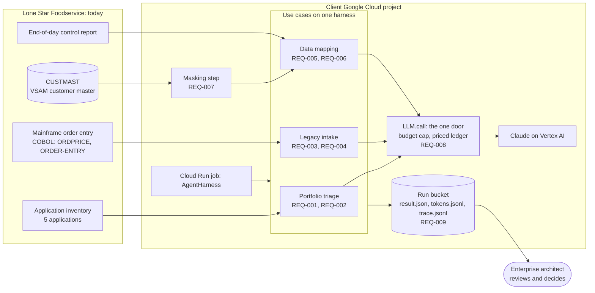
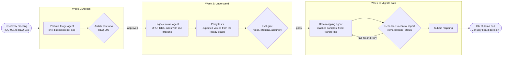

# Design (simulated)

Two views, kept as Mermaid here so they version with the code. Lucidchart copies, with the
same content, are what the client sees.

- `context.mmd`: what runs where. Legacy sources on the left, the client's Google Cloud
  project in the middle, the architect who decides on the right.
- `roadmap.mmd`: three weeks, three phases, a human or deterministic gate at the end of each.

## System context

## Roadmap

## What the design says, in one line each

- One harness, three use cases; every model call goes through one door that prices it and enforces the budget (REQ-008).
- Personal data is masked before any model sees it (REQ-007).
- Every gate is either a person (architect review) or arithmetic (oracle, reconciliation). No model grades a model.
- Evidence lands in a bucket the client owns (REQ-009, REQ-010).
